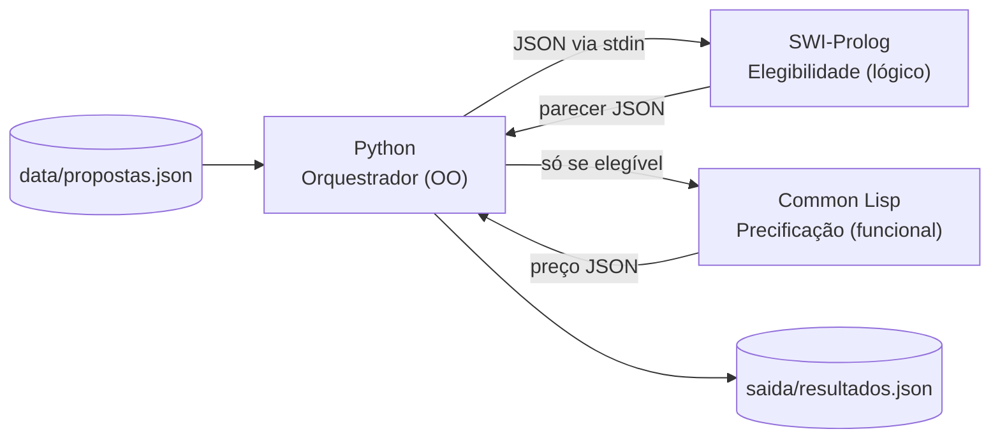

<div align="center">

# Validação de Crédito Multiparadigma

**Python orientado a objetos · SWI-Prolog lógico · Common Lisp funcional**

<br>


<br>


<br><br>

<em>Trabalho Final de Laboratório de Programação · 2026.2</em>

</div>

---

## Sumário

<div align="center">
<table>
  <tr>
    <td align="left">
      <a href="#sobre-o-projeto">Sobre o projeto</a><br>
      <a href="#como-funciona">Como funciona</a><br>
      <a href="#regras-de-negócio">Regras de negócio</a><br>
      <a href="#instalação-e-execução">Instalação e execução</a><br>
      <a href="#testes-e-métricas">Testes e métricas</a>
    </td>
    <td align="left">
      <a href="#contrato-json">Contrato JSON</a><br>
      <a href="#estrutura-do-projeto">Estrutura do projeto</a><br>
      <a href="#solução-de-problemas">Solução de problemas</a><br>
      <a href="#autoria">Autoria</a>
    </td>
  </tr>
</table>
</div>

---

## Sobre o projeto

<div align="justify">
Sistema acadêmico de <strong>validação de crédito</strong> que lê propostas fictícias de clientes, decide se cada uma é elegível e, quando for, calcula o <strong>risco</strong>, a <strong>taxa de juros</strong>, o <strong>limite de crédito</strong> e o <strong>valor da parcela</strong>. O mesmo problema é resolvido combinando três paradigmas de programação, e cada um assume a parte para a qual é mais adequado: objetos para modelar e coordenar, lógica para as regras de elegibilidade e funções puras para o cálculo financeiro.
</div>

<br>

> 💡 Todos os dados são fictícios e as regras de negócio são simplificações didáticas. O projeto não representa um modelo financeiro real.

---

## Como funciona



<div align="justify">
Para cada proposta, o orquestrador em Python valida os dados, monta os objetos de domínio e consulta o Prolog. Se o parecer for negativo, a proposta termina como <code>REPROVADO</code> e o Lisp nem é acionado. Se for positivo, o Lisp classifica o risco e calcula os valores. A comunicação entre os processos é feita por JSON em <code>stdin</code> e <code>stdout</code>, seguindo o <a href="docs/contrato_json.md">contrato de integração</a>. Um registro com problema nunca interrompe o lote.
</div>

<br>

<div align="center">
<table>
  <tr>
    <th align="center">Paradigma</th>
    <th align="center">Linguagem</th>
    <th align="center">Responsabilidade</th>
    <th align="center">Arquivos</th>
  </tr>
  <tr>
    <td align="left"><strong>Orientado a objetos</strong></td>
    <td align="left">Python 3.12</td>
    <td align="left">Classes <code>Cliente</code>, <code>Proposta</code> e <code>AnaliseRisco</code>, validação, orquestração, ordenação por merge sort e integração com os outros módulos</td>
    <td align="left"><code>main.py</code><br><code>python/</code></td>
  </tr>
  <tr>
    <td align="left"><strong>Lógico</strong></td>
    <td align="left">SWI-Prolog</td>
    <td align="left">Fatos e regras de elegibilidade e compliance, com recursão e <code>findall/3</code></td>
    <td align="left"><code>prolog/elegibilidade.pl</code></td>
  </tr>
  <tr>
    <td align="left"><strong>Funcional</strong></td>
    <td align="left">Common Lisp (SBCL)</td>
    <td align="left">Classificação de risco, juros pela Tabela Price, limite de crédito e tabela de amortização, com funções puras</td>
    <td align="left"><code>lisp/precificacao.lisp</code></td>
  </tr>
</table>
</div>

---

## Regras de negócio

<div align="center">
<table>
  <tr>
    <th align="center">Critério de elegibilidade (Prolog)</th>
    <th align="center">Regra</th>
    <th align="center">Impedimento gerado</th>
  </tr>
  <tr>
    <td align="left"><strong>Renda mínima</strong></td>
    <td align="left">renda mensal ≥ R$ 1.500,00</td>
    <td align="left"><code>renda_abaixo_do_minimo</code></td>
  </tr>
  <tr>
    <td align="left"><strong>Idade mínima</strong></td>
    <td align="left">idade ≥ 18 anos</td>
    <td align="left"><code>idade_abaixo_do_minimo</code></td>
  </tr>
  <tr>
    <td align="left"><strong>Prazo</strong></td>
    <td align="left">6 ou 12 meses</td>
    <td align="left"><code>prazo_invalido</code></td>
  </tr>
  <tr>
    <td align="left"><strong>Histórico</strong></td>
    <td align="left"><code>bom</code> e <code>regular</code> aceitos; <code>ruim</code> só com comprometimento ≤ 15%</td>
    <td align="left"><code>historico_nao_aceito</code></td>
  </tr>
  <tr>
    <td align="left"><strong>Comprometimento da renda</strong></td>
    <td align="left">parcela sem juros ≤ 30% da renda</td>
    <td align="left"><code>comprometimento_acima_30_porcento</code></td>
  </tr>
</table>
</div>

<br>

<div align="center">
<table>
  <tr>
    <th align="center">Risco (Lisp)</th>
    <th align="center">Quando se aplica</th>
    <th align="center">Taxa mensal</th>
    <th align="center">Status final</th>
  </tr>
  <tr>
    <td align="left"><strong>baixo</strong></td>
    <td align="left">histórico <code>bom</code> e comprometimento ≤ 20%</td>
    <td align="center">1,5%</td>
    <td align="left"><code>APROVADO</code></td>
  </tr>
  <tr>
    <td align="left"><strong>médio</strong></td>
    <td align="left">demais casos</td>
    <td align="center">2,5%</td>
    <td align="left"><code>APROVADO</code></td>
  </tr>
  <tr>
    <td align="left"><strong>alto</strong></td>
    <td align="left">histórico <code>ruim</code>, ou <code>regular</code> com comprometimento &gt; 20%</td>
    <td align="center">3,5%</td>
    <td align="left"><code>APROVADO_COM_CONDICOES</code></td>
  </tr>
</table>
</div>

<br>

<div align="justify">
<strong>Cálculos:</strong> o limite é o menor valor entre <code>renda × 0,30 × prazo</code> e o teto de <strong>R$ 20.000,00</strong>. O valor aprovado é o menor entre o valor solicitado e o limite. A parcela final usa juros compostos pela <strong>Tabela Price</strong>: <code>PMT = V · i / (1 − (1 + i)^−n)</code>.
</div>

<br>

> ⁉️ O limite de 30% vale para a parcela **sem juros**. Com juros, a parcela final pode ultrapassar 30% da renda, e isso é aceito nesta versão.

---

## Instalação e execução

### Ferramentas necessárias

<div align="center">
<table>
  <tr>
    <th align="center">Ferramenta</th>
    <th align="center">Versão testada</th>
    <th align="center">Para quê</th>
  </tr>
  <tr>
    <td align="left"><strong>Git</strong></td>
    <td align="center">qualquer</td>
    <td align="left">baixar o projeto</td>
  </tr>
  <tr>
    <td align="left"><strong>Python</strong></td>
    <td align="center">3.12</td>
    <td align="left">orquestrador (sem pacotes externos)</td>
  </tr>
  <tr>
    <td align="left"><strong>SWI-Prolog</strong></td>
    <td align="center">9.0.4</td>
    <td align="left">motor de elegibilidade</td>
  </tr>
  <tr>
    <td align="left"><strong>SBCL</strong></td>
    <td align="center">2.2.9</td>
    <td align="left">núcleo de precificação</td>
  </tr>
  <tr>
    <td align="left"><strong>yason</strong></td>
    <td align="center">biblioteca Lisp</td>
    <td align="left">leitura de JSON no Lisp</td>
  </tr>
</table>
</div>

<br>

> ⁉️ Validado em **Ubuntu 24.04**. No Windows há duas opções: **WSL2** (recomendada, usa os mesmos comandos do Ubuntu) ou instalação nativa.

### Passo 1: instalar as dependências

<details open>
<summary><strong>Ubuntu / Debian / WSL2</strong></summary>

<br>

```bash
sudo apt update
sudo apt install -y git python3 swi-prolog-nox sbcl cl-yason cl-alexandria cl-babel cl-trivial-gray-streams
```

</details>

<details>
<summary><strong>Windows com WSL2 (recomendado)</strong></summary>

<br>

1. Abra o **PowerShell como administrador** e execute `wsl --install -d Ubuntu`. Reinicie o computador se for solicitado.
2. Abra o aplicativo **Ubuntu** pelo menu Iniciar e crie o usuário e a senha.
3. No terminal do Ubuntu, execute os comandos da aba **Ubuntu / Debian** acima.
4. Siga os passos 2 a 4 abaixo **dentro do terminal do Ubuntu**.

> 💡 Clone o projeto dentro do sistema de arquivos do Ubuntu (por exemplo, em `~/`) e não em `/mnt/c`, que é bem mais lento.

</details>

<details>
<summary><strong>Windows nativo (PowerShell)</strong></summary>

<br>

1. Instale as ferramentas pelos sites oficiais:
   - **Git:** [git-scm.com](https://git-scm.com/download/win)
   - **Python 3.12:** [python.org](https://www.python.org/downloads/windows/), marcando `Add python.exe to PATH`
   - **SWI-Prolog:** [swi-prolog.org](https://www.swi-prolog.org/Download.html), marcando a opção de adicionar ao `PATH`
   - **SBCL:** [sbcl.org](https://www.sbcl.org/platform-table.html), binário para Windows, com a pasta de instalação no `PATH`
2. Feche e abra o PowerShell para atualizar o `PATH`.
3. Instale o Quicklisp e o yason:

```powershell
curl.exe -O https://beta.quicklisp.org/quicklisp.lisp
sbcl --non-interactive --load quicklisp.lisp --eval '(quicklisp-quickstart:install)' --eval '(ql:quickload :yason)'
```

> ⚠️ No Windows nativo, use `python` no lugar de `python3` em todos os comandos dos passos seguintes.

> ⁉️ Esta opção não foi validada no ambiente de testes do projeto (Ubuntu). Se algo falhar, use o WSL2.

</details>

> 💡 No Ubuntu e no WSL2, o `cl-yason` precisa dos pacotes `cl-alexandria`, `cl-babel` e `cl-trivial-gray-streams`, que em versões novas do Ubuntu **não** são instalados automaticamente. No Windows nativo, o Quicklisp faz esse papel e o código Lisp o encontra na pasta `quicklisp` do seu usuário sozinho.

### Passo 2: baixar o projeto

```bash
git clone https://github.com/<usuario>/validacao-credito-multiparadigma.git
cd validacao-credito-multiparadigma
```

> ⚠️ Substitua `<usuario>` pelo usuário ou organização do GitHub dona do repositório.

### Passo 3: conferir a instalação

```bash
python3 --version
swipl --version
sbcl --version
```

> 💡 No Windows nativo, use `python --version`.

### Passo 4: executar

```bash
python3 main.py
```

> ⚠️ Execute sempre a partir da **raiz do projeto**, porque os caminhos padrão (`data/propostas.json` e `saida/`) são relativos a ela.

> 💡 Na primeira execução o SBCL pode levar alguns segundos a mais para compilar o yason. As seguintes são rápidas.

### Saída esperada

```text
PROP-001   APROVADO                 risco baixo, aprovado R$ 4200.00, parcela R$ 385.06
PROP-002   APROVADO                 risco medio, aprovado R$ 4000.00, parcela R$ 389.95
PROP-003   APROVADO_COM_CONDICOES   risco alto, aprovado R$ 10800.00, parcela R$ 1117.63
...
PROP-009   REPROVADO                idade_abaixo_do_minimo
PROP-010   REPROVADO                renda_abaixo_do_minimo
...

Resumo: {'APROVADO': 21, 'APROVADO_COM_CONDICOES': 7, 'REPROVADO': 26, 'ERRO_VALIDACAO': 6}
Resultados gravados em saida/resultados.json
```

<div align="center">
<table>
  <tr>
    <th align="center">Status</th>
    <th align="center">Significado</th>
  </tr>
  <tr>
    <td align="left"><code>APROVADO</code></td>
    <td align="left">elegível, risco baixo ou médio</td>
  </tr>
  <tr>
    <td align="left"><code>APROVADO_COM_CONDICOES</code></td>
    <td align="left">elegível, risco alto</td>
  </tr>
  <tr>
    <td align="left"><code>REPROVADO</code></td>
    <td align="left">o Prolog encontrou impedimentos (listados no resultado)</td>
  </tr>
  <tr>
    <td align="left"><code>ERRO_VALIDACAO</code></td>
    <td align="left">registro com chave ausente, tipo errado ou valor inválido</td>
  </tr>
  <tr>
    <td align="left"><code>ERRO_INTEGRACAO</code></td>
    <td align="left">falha ao executar Prolog ou Lisp (timeout, saída malformada, programa ausente)</td>
  </tr>
</table>
</div>

### Opções de linha de comando

```bash
python3 main.py --entrada data/propostas.json --saida saida/resultados.json
python3 data/gerar_dataset.py
```

---

## Testes e métricas

```bash
python3 -m unittest discover -v
python3 data/metricas.py --casos 5
```

<div align="justify">
Os <strong>49 testes</strong> cobrem as classes de domínio, o merge sort, o fluxo do orquestrador (com módulos simulados) e a execução de ponta a ponta com Prolog e Lisp reais, incluindo casos de borda como renda exatamente R$ 1.500,00, comprometimento exatamente 30%, idade 18 e 17, prazo inválido e teto de crédito. Os testes de ponta a ponta são ignorados automaticamente se <code>swipl</code> ou <code>sbcl</code> não estiverem instalados. O script <code>data/metricas.py</code> mostra linhas de código, quantidade de funções ou predicados por linguagem, número de testes e o tempo médio de execução.
</div>

---

## Contrato JSON

<div align="justify">
Todas as mensagens trafegam em JSON UTF-8 por <code>stdin</code> e <code>stdout</code>, uma proposta por execução. O formato de cada fronteira (Python ↔ Prolog e Python ↔ Lisp), as decisões de negócio e o tratamento de erros estão em <a href="docs/contrato_json.md"><strong>docs/contrato_json.md</strong></a>.
</div>

---

## Estrutura do projeto

```text
validacao-credito-multiparadigma/
├── main.py                    ponto de entrada único
├── data/
│   ├── propostas.json         60 propostas fictícias (casos de borda e aleatórias)
│   ├── gerar_dataset.py       gera o dataset
│   └── metricas.py            métricas para o relatório
├── python/
│   ├── dominio.py             Cliente, Proposta, AnaliseRisco, merge sort
│   ├── integracao.py          chamada de Prolog e Lisp com timeout
│   ├── orquestrador.py        fluxo por proposta e por lote
│   └── tests/                 testes unitários e de integração
├── prolog/
│   └── elegibilidade.pl       fatos e regras de elegibilidade
├── lisp/
│   └── precificacao.lisp      risco, juros, limite e parcela
└── docs/
    └── contrato_json.md       contrato de integração v1.1
```

---

## Solução de problemas

<details>
<summary><strong><code>swipl</code> ou <code>sbcl</code> não é reconhecido</strong></summary>

<br>

O programa não está no `PATH`. Reinstale pelo Passo 1 e abra um novo terminal (no Windows nativo, feche e abra o PowerShell). Sem eles, o `main.py` registra `ERRO_INTEGRACAO` para cada proposta.

</details>

<details>
<summary><strong>Erro "falha ao carregar o yason" ou <code>ERRO_INTEGRACAO</code> em todas as propostas aprovadas</strong></summary>

<br>

No Ubuntu e no WSL2, instale `sudo apt install cl-yason cl-alexandria cl-babel cl-trivial-gray-streams`. No Windows nativo, rode o Quicklisp do Passo 1 e confirme que a pasta `quicklisp` existe dentro da pasta do seu usuário.

</details>

<details>
<summary><strong>Erro ao ler <code>data/propostas.json</code></strong></summary>

<br>

Execute o comando na raiz do projeto ou gere o arquivo de novo com `python3 data/gerar_dataset.py`.

</details>

---

## Autoria

<div align="center">
<table>
  <tr>
    <th align="center">Integrante</th>
    <th align="center">Responsabilidade</th>
  </tr>
  <tr>
    <td align="left"><strong>Anderson da Silva Pinto</strong></td>
    <td align="left">Orquestrador, integração entre os módulos, contrato JSON e repositório</td>
  </tr>
  <tr>
    <td align="left"><strong>Luciene da Costa Martins</strong></td>
    <td align="left">Classes de domínio em Python (orientação a objetos) e testes unitários</td>
  </tr>
  <tr>
    <td align="left"><strong>Pedro Rodrigues Pinto Neto</strong></td>
    <td align="left">Motor lógico em Prolog</td>
  </tr>
  <tr>
    <td align="left"><strong>Isabelle Stefany Silva Dias</strong></td>
    <td align="left">Núcleo funcional em Common Lisp</td>
  </tr>
  <tr>
    <td align="left"><strong>Robson Gabriel de Oliveira Lima</strong></td>
    <td align="left">Dataset, testes de integração e métricas</td>
  </tr>
</table>
</div>

<br>

<div align="center">

**Trabalho apresentado ao Professor Dr. Sofiane Labidi**

Universidade Federal do Maranhão (UFMA)<br>
Laboratório de Programação · 2026.2

</div>
