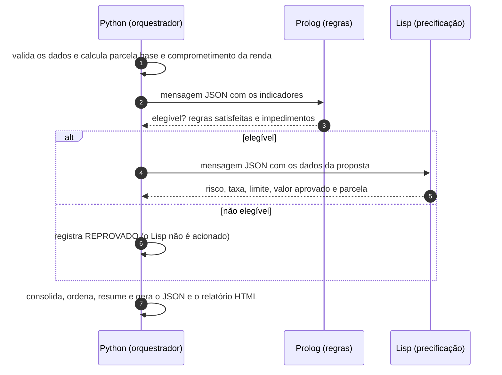

<div align="center">

# Validação de Crédito Multiparadigma

**Um mesmo problema resolvido por três paradigmas de programação, trabalhando juntos**

<br>


<br>


<br><br>

<em>Trabalho Final de Laboratório de Programação · 2026.2 · Universidade Federal do Maranhão</em>

<br><br>

<a href="#sobre-o-projeto">Sobre</a> ·
<a href="#como-funciona">Como funciona</a> ·
<a href="#regras-de-negócio">Regras</a> ·
<a href="#instalação-no-windows">Instalação</a> ·
<a href="#executando-o-projeto">Executando</a> ·
<a href="#testes-e-métricas">Testes</a> ·
<a href="#solução-de-problemas">Problemas</a> ·
<a href="#autoria">Autoria</a>

</div>

---

## Sobre o projeto

<div align="justify">
Este sistema analisa <strong>propostas de crédito</strong> de clientes fictícios e decide o que fazer com cada uma: <strong>aprovar</strong>, <strong>aprovar com condições</strong> ou <strong>reprovar</strong>. Para as propostas aprovadas, ele ainda calcula o <strong>risco</strong> do cliente, a <strong>taxa de juros</strong>, o <strong>limite de crédito</strong>, o <strong>valor aprovado</strong> e a <strong>parcela mensal</strong>.
</div>

<br>

<div align="justify">
O objetivo acadêmico é resolver esse problema com <strong>três paradigmas</strong> e comparar o que cada um oferece. Em vez de três programas separados, eles formam <strong>um sistema só</strong>: cada paradigma cuida da parte para a qual é mais adequado, e os três conversam por mensagens JSON.
</div>

<br>

<div align="center">
<table>
  <tr>
    <th align="center">Paradigma</th>
    <th align="center">Pergunta que responde</th>
    <th align="center">O que faz neste projeto</th>
  </tr>
  <tr>
    <td align="left"><strong>Orientado a objetos</strong><br><sub>Python</sub></td>
    <td align="left"><em>Quais entidades existem e o que cada uma sabe fazer?</em></td>
    <td align="left">Modela <code>Cliente</code>, <code>Proposta</code> e <code>AnaliseRisco</code>, valida os dados, coordena os outros dois módulos e apresenta o resultado</td>
  </tr>
  <tr>
    <td align="left"><strong>Lógico</strong><br><sub>SWI-Prolog</sub></td>
    <td align="left"><em>Quais fatos são verdadeiros e quais regras se aplicam?</em></td>
    <td align="left">Decide a <strong>elegibilidade</strong> com fatos e regras e informa quais critérios foram atendidos e quais impedem a aprovação</td>
  </tr>
  <tr>
    <td align="left"><strong>Funcional</strong><br><sub>Common Lisp (SBCL)</sub></td>
    <td align="left"><em>Como um dado se transforma em outro?</em></td>
    <td align="left">Transforma o perfil do cliente, etapa por etapa, até chegar a risco, taxa, limite, valor aprovado e parcela</td>
  </tr>
</table>
</div>

<br>

> 💡 Todos os dados são fictícios e as regras de negócio são simplificações didáticas. O projeto não representa um modelo financeiro real.

---

## Como funciona

### O caminho de cada proposta



<div align="justify">
O Python lê o arquivo de propostas e processa <strong>uma de cada vez</strong>. Uma proposta com problema <strong>nunca interrompe o lote</strong>: o erro vira um status no resultado e o programa segue para a próxima. A comunicação com o Prolog e o Lisp usa JSON pela entrada e saída padrão (<code>stdin</code> e <code>stdout</code>), no formato descrito no <a href="docs/contrato_json.md">contrato de integração</a>.
</div>

### O que o sistema analisa

<div align="center">
<table>
  <tr>
    <th align="center">#</th>
    <th align="center">Etapa</th>
    <th align="center">Quem</th>
    <th align="center">O que analisa</th>
  </tr>
  <tr>
    <td align="center">1</td>
    <td align="left"><strong>Validação</strong></td>
    <td align="center">Python</td>
    <td align="left">Campos obrigatórios, tipos e valores (renda, prazo e valor positivos, idade não negativa). Se falhar: <code>ERRO_VALIDACAO</code></td>
  </tr>
  <tr>
    <td align="center">2</td>
    <td align="left"><strong>Indicadores</strong></td>
    <td align="center">Python</td>
    <td align="left">Parcela base (valor ÷ prazo) e comprometimento da renda (parcela ÷ renda)</td>
  </tr>
  <tr>
    <td align="center">3</td>
    <td align="left"><strong>Elegibilidade</strong></td>
    <td align="center">Prolog</td>
    <td align="left">Cinco critérios: renda, idade, prazo, histórico e comprometimento. Devolve o que passou e o que impede</td>
  </tr>
  <tr>
    <td align="center">4</td>
    <td align="left"><strong>Risco e taxa</strong></td>
    <td align="center">Lisp</td>
    <td align="left">Cruza histórico e comprometimento para classificar o risco em baixo, médio ou alto, e define a taxa mensal</td>
  </tr>
  <tr>
    <td align="center">5</td>
    <td align="left"><strong>Limite e valor aprovado</strong></td>
    <td align="center">Lisp</td>
    <td align="left">Limite pela renda, com teto de crédito, e valor aprovado (o menor entre o solicitado e o limite)</td>
  </tr>
  <tr>
    <td align="center">6</td>
    <td align="left"><strong>Parcela</strong></td>
    <td align="center">Lisp</td>
    <td align="left">Parcela pela Tabela Price, conferida por uma tabela de amortização que deve quitar o saldo</td>
  </tr>
  <tr>
    <td align="center">7</td>
    <td align="left"><strong>Consolidação</strong></td>
    <td align="center">Python</td>
    <td align="left">Status final, ranking dos maiores valores aprovados (merge sort da equipe), resumo, JSON e relatório HTML</td>
  </tr>
</table>
</div>

### Exemplo: acompanhando uma proposta

<table>
  <tr>
    <td valign="top" width="50%">

**PROP-001, aprovada** · cliente de 30 anos, renda de R$ 3.500,00, histórico `bom`, pede R$ 4.200,00 em 12 meses

1. **Python:** parcela base = 4.200 ÷ 12 = **R$ 350,00**, que é **10%** da renda
2. **Prolog:** os 5 critérios são atendidos, então a proposta é **elegível**
3. **Lisp:**
   - risco **baixo** (histórico `bom` e comprometimento até 20%), taxa **1,5% a.m.**
   - limite = menor entre 3.500 × 0,30 × 12 = 12.600 e o teto de 20.000 = **R$ 12.600,00**
   - valor aprovado = menor entre 4.200 e 12.600 = **R$ 4.200,00**
   - parcela pela Tabela Price = **R$ 385,06**

</td>
    <td valign="top" width="50%">

**PROP-009, reprovada** · cliente de 17 anos, renda de R$ 2.500,00, histórico `bom`, pede R$ 3.000,00 em 6 meses

1. **Python:** parcela base = 3.000 ÷ 6 = **R$ 500,00**, que é **20%** da renda
2. **Prolog:** renda, prazo, histórico e comprometimento passam, mas a **idade (17) está abaixo do mínimo**. Resultado: **não elegível**, com o impedimento `idade_abaixo_do_minimo`
3. **Lisp:** **não é acionado**, porque o Prolog já reprovou

Status final: **REPROVADO**

</td>
  </tr>
</table>

Para ver esse caminho no seu terminal, use `python3 main.py --detalhe PROP-001`.

### Entrada e saída

Cada proposta do arquivo `data/propostas.json` tem seis campos:

```json
{
  "id": "PROP-001",
  "idade": 30,
  "renda_mensal": 3500.00,
  "historico_credito": "bom",
  "valor_solicitado": 4200.00,
  "prazo": 12
}
```

E o resultado de cada proposta (em `saida/resultados.json`) traz o status final, os impedimentos, se houver, e a precificação:

```json
{
  "id": "PROP-001",
  "status": "APROVADO",
  "impedimentos": [],
  "precificacao": {
    "classificacao_risco": "baixo",
    "taxa_juros_mensal": 0.015,
    "limite_calculado": 12600.0,
    "valor_aprovado": 4200.0,
    "valor_parcela_final": 385.06
  },
  "erro": null
}
```

---

## Regras de negócio

<div align="center">
<table>
  <tr>
    <th align="center">Critério de elegibilidade (Prolog)</th>
    <th align="center">Regra</th>
    <th align="center">Impedimento gerado</th>
  </tr>
  <tr>
    <td align="left"><strong>Renda mínima</strong></td>
    <td align="left">renda mensal ≥ R$ 1.500,00</td>
    <td align="left"><code>renda_abaixo_do_minimo</code></td>
  </tr>
  <tr>
    <td align="left"><strong>Idade mínima</strong></td>
    <td align="left">idade ≥ 18 anos</td>
    <td align="left"><code>idade_abaixo_do_minimo</code></td>
  </tr>
  <tr>
    <td align="left"><strong>Prazo</strong></td>
    <td align="left">6 ou 12 meses</td>
    <td align="left"><code>prazo_invalido</code></td>
  </tr>
  <tr>
    <td align="left"><strong>Histórico</strong></td>
    <td align="left"><code>bom</code> e <code>regular</code> aceitos; <code>ruim</code> só com comprometimento ≤ 15%</td>
    <td align="left"><code>historico_nao_aceito</code></td>
  </tr>
  <tr>
    <td align="left"><strong>Comprometimento da renda</strong></td>
    <td align="left">parcela sem juros ≤ 30% da renda</td>
    <td align="left"><code>comprometimento_acima_30_porcento</code></td>
  </tr>
</table>
</div>

<br>

<div align="center">
<table>
  <tr>
    <th align="center">Risco (Lisp)</th>
    <th align="center">Quando se aplica</th>
    <th align="center">Taxa mensal</th>
    <th align="center">Status final</th>
  </tr>
  <tr>
    <td align="left"><strong>baixo</strong></td>
    <td align="left">histórico <code>bom</code> e comprometimento ≤ 20%</td>
    <td align="center">1,5%</td>
    <td align="left"><code>APROVADO</code></td>
  </tr>
  <tr>
    <td align="left"><strong>médio</strong></td>
    <td align="left">demais casos</td>
    <td align="center">2,5%</td>
    <td align="left"><code>APROVADO</code></td>
  </tr>
  <tr>
    <td align="left"><strong>alto</strong></td>
    <td align="left">histórico <code>ruim</code>, ou <code>regular</code> com comprometimento &gt; 20%</td>
    <td align="center">3,5%</td>
    <td align="left"><code>APROVADO_COM_CONDICOES</code></td>
  </tr>
</table>
</div>

<br>

<div align="justify">
<strong>Cálculos:</strong> o limite é o menor valor entre <code>renda × 0,30 × prazo</code> e o teto de <strong>R$ 20.000,00</strong>. O valor aprovado é o menor entre o valor solicitado e o limite. A parcela usa juros compostos pela <strong>Tabela Price</strong>: <code>PMT = V · i / (1 − (1 + i)^−n)</code>.
</div>

<br>

> ⁉️ O limite de 30% vale para a parcela **sem juros**. Com juros, a parcela final pode ultrapassar 30% da renda, e isso é aceito nesta versão.

---

## Instalação no Windows

O projeto roda no Windows por meio do **WSL2**, que executa um Ubuntu dentro do próprio Windows. Todo o passo a passo abaixo foi seguido e validado dessa forma.

<div align="center">
<table>
  <tr>
    <th align="center">Ferramenta</th>
    <th align="center">Para que serve</th>
    <th align="center">Versões validadas</th>
  </tr>
  <tr>
    <td align="left"><strong>WSL2 + Ubuntu</strong></td>
    <td align="left">ambiente Linux dentro do Windows</td>
    <td align="center">WSL 3.0.5 · Ubuntu 26.04</td>
  </tr>
  <tr>
    <td align="left"><strong>Python</strong></td>
    <td align="left">orquestrador (sem pacotes externos)</td>
    <td align="center">3.14.4 (também 3.12)</td>
  </tr>
  <tr>
    <td align="left"><strong>SWI-Prolog</strong></td>
    <td align="left">motor de elegibilidade</td>
    <td align="center">9.2.9 (também 9.0.4)</td>
  </tr>
  <tr>
    <td align="left"><strong>SBCL</strong></td>
    <td align="left">núcleo de precificação em Common Lisp</td>
    <td align="center">2.6.0 (também 2.2.9)</td>
  </tr>
  <tr>
    <td align="left"><strong>yason</strong></td>
    <td align="left">leitura de JSON no Lisp</td>
    <td align="center">0.7.6</td>
  </tr>
</table>
</div>

<br>

> 💡 Você precisa de um Windows 10 (versão 2004 ou superior) ou Windows 11, com a virtualização ativada na BIOS (o normal nos computadores atuais). A instalação ocupa cerca de **2 a 3 GB**.

### Passo 1: instalar o WSL2 e o Ubuntu

1. Abra o menu Iniciar, digite **PowerShell**, clique com o botão direito e escolha **Executar como administrador**.
2. Confira se o WSL já existe:

   ```powershell
   wsl -l -v
   ```

   Se aparecer a mensagem **"O Subsistema do Windows para Linux não está instalado"**, aperte qualquer tecla quando o Windows oferecer a instalação. Ele baixa o WSL e ativa a Plataforma de Máquina Virtual.
3. **Reinicie o computador** quando a instalação avisar que as alterações só valem depois da reinicialização.
4. Depois de reiniciar, abra o PowerShell como administrador de novo e instale o Ubuntu:

   ```powershell
   wsl --install -d Ubuntu
   ```

5. Quando o Ubuntu abrir numa janela preta, ele pede um **nome de usuário** e uma **senha**. Escolha os dois, com o usuário em minúsculas e sem espaços.

> ⚠️ A senha **não aparece enquanto você digita**. É assim mesmo, continue digitando e aperte Enter.

Quando surgir um prompt parecido com `usuario@COMPUTADOR:~$`, o Ubuntu está pronto. Para abri-lo de novo depois, procure **Ubuntu** no menu Iniciar. **Todos os passos a seguir são feitos nessa janela do Ubuntu.**

### Passo 2: instalar Python, Prolog e Lisp

```bash
sudo apt update
sudo apt install -y git python3 swi-prolog-nox sbcl cl-yason cl-alexandria cl-babel cl-trivial-gray-streams unzip
```

<div align="center">
<table>
  <tr>
    <th align="center">Pacote</th>
    <th align="center">Função</th>
  </tr>
  <tr>
    <td align="left"><code>git</code> e <code>unzip</code></td>
    <td align="left">baixar e extrair o projeto</td>
  </tr>
  <tr>
    <td align="left"><code>python3</code></td>
    <td align="left">executa o orquestrador</td>
  </tr>
  <tr>
    <td align="left"><code>swi-prolog-nox</code></td>
    <td align="left">SWI-Prolog, em versão sem interface gráfica</td>
  </tr>
  <tr>
    <td align="left"><code>sbcl</code></td>
    <td align="left">compilador e executor de Common Lisp</td>
  </tr>
  <tr>
    <td align="left"><code>cl-yason</code> + <code>cl-alexandria</code>, <code>cl-babel</code>, <code>cl-trivial-gray-streams</code></td>
    <td align="left">biblioteca de JSON do Lisp e as três bibliotecas de que ela depende</td>
  </tr>
</table>
</div>

<br>

> ⚠️ Nas versões novas do Ubuntu, o `cl-yason` **não instala sozinho** as outras três bibliotecas. Sem elas, todas as propostas aprovadas terminam em `ERRO_INTEGRACAO`. Por isso elas estão no comando acima.

O `apt` mostra o espaço que vai usar e, quando você tirar o `-y`, pergunta se pode continuar. Confira as versões instaladas:

```bash
python3 --version
swipl --version
sbcl --version
```

Os três precisam responder com um número de versão.

### Passo 3: baixar o projeto

Faça isso dentro da pasta pessoal do Ubuntu (`~`) e **não** em `/mnt/c`, que é bem mais lento.

<details open>
<summary><strong>Opção A: pelo Git (recomendada)</strong></summary>

<br>

```bash
cd ~
git clone https://github.com/<usuario>/validacao-credito-multiparadigma.git
cd validacao-credito-multiparadigma
```

Troque `<usuario>` pelo usuário ou organização dona do repositório. Se o repositório for **privado**, o Git pede usuário e, no lugar da senha, um **token de acesso pessoal** do GitHub.

</details>

<details>
<summary><strong>Opção B: pelo ZIP baixado no navegador</strong></summary>

<br>

No GitHub, clique em **Code › Download ZIP**. O arquivo vai para a pasta Downloads do Windows. Depois, no Ubuntu:

```bash
cd ~
cp /mnt/c/Users/<seu-usuario-windows>/Downloads/validacao-credito-multiparadigma-main.zip .
unzip validacao-credito-multiparadigma-main.zip
cd validacao-credito-multiparadigma-main
```

`<seu-usuario-windows>` é o nome da sua pasta em `C:\Users`. Se o navegador salvou o ZIP com outro nome, como `(1)` no final, use o nome real entre aspas no `cp`.

</details>

Confirme que está na raiz do projeto:

```bash
ls
```

Deve aparecer `README.md  data  docs  lisp  main.py  prolog  python  tests`.

---

## Executando o projeto

Sempre a partir da **raiz do projeto**:

```bash
python3 main.py
```

> 💡 Na primeira execução o SBCL compila o yason, e pode levar alguns segundos sem imprimir nada. As próximas são rápidas.

O terminal mostra uma tabela colorida (verde para aprovado, amarelo para aprovado com condições, vermelho para reprovado, roxo para erro), um resumo com barras e o ranking dos maiores valores aprovados:

```text
╔══════════════════════════════════════════════════════════════╗
║ VALIDAÇÃO DE CRÉDITO  ·  Python + Prolog + Lisp              ║
╠══════════════════════════════════════════════════════════════╣
║ Python orquestra  ·  Prolog decide  ·  Lisp precifica        ║
╚══════════════════════════════════════════════════════════════╝

ID        STATUS                           APROVADO       PARCELA   DETALHE
────────────────────────────────────────────────────────────────────────────────────────────────
PROP-001  ✔ Aprovado                    R$ 4.200,00     R$ 385,06   risco baixo · taxa 1,5% a.m.
PROP-002  ✔ Aprovado                    R$ 4.000,00     R$ 389,95   risco medio · taxa 2,5% a.m.
PROP-003  ▲ Aprovado com condições     R$ 10.800,00   R$ 1.117,63   risco alto · taxa 3,5% a.m.
...
PROP-009  ✘ Reprovado                             -             -   idade_abaixo_do_minimo
...

RESUMO  (60 propostas)
  ✔ Aprovado                  21  ████████░░░░░░░░░░░░░░░░   35%
  ▲ Aprovado com condições     7  ███░░░░░░░░░░░░░░░░░░░░░   12%
  ✘ Reprovado                 26  ██████████░░░░░░░░░░░░░░   43%
  ! Erro de validação          6  ██░░░░░░░░░░░░░░░░░░░░░░   10%
  ‼ Erro de integração         0  ░░░░░░░░░░░░░░░░░░░░░░░░    0%
```

<div align="center">
<table>
  <tr>
    <th align="center">Status</th>
    <th align="center">Significado</th>
  </tr>
  <tr>
    <td align="left"><code>APROVADO</code></td>
    <td align="left">elegível, com risco baixo ou médio</td>
  </tr>
  <tr>
    <td align="left"><code>APROVADO_COM_CONDICOES</code></td>
    <td align="left">elegível, com risco alto</td>
  </tr>
  <tr>
    <td align="left"><code>REPROVADO</code></td>
    <td align="left">o Prolog encontrou impedimentos, que ficam listados no resultado</td>
  </tr>
  <tr>
    <td align="left"><code>ERRO_VALIDACAO</code></td>
    <td align="left">registro com campo ausente, tipo errado ou valor inválido</td>
  </tr>
  <tr>
    <td align="left"><code>ERRO_INTEGRACAO</code></td>
    <td align="left">falha ao executar o Prolog ou o Lisp (tempo esgotado, saída malformada, programa ausente)</td>
  </tr>
</table>
</div>

### Opções de linha de comando

```bash
python3 main.py                          # tabela, resumo, ranking, JSON e HTML
python3 main.py --detalhe PROP-001       # caminho de uma proposta pelos três módulos
python3 main.py --sem-cor                # sem cores no terminal
python3 main.py --entrada outro.json --saida saida/x.json --html saida/x.html
python3 data/gerar_dataset.py            # regenera o dataset
```

### Acompanhar uma proposta pelos três módulos

```bash
python3 main.py --detalhe PROP-001
```

```text
PROP-001  ✔ Aprovado

1  PYTHON  (orientado a objetos)  valida os dados e calcula os indicadores
     parcela base R$ 350,00 · comprometimento 10,00% da renda

2  PROLOG  (lógico)  verifica as regras de elegibilidade
     ✔ renda_minima
     ✔ idade_minima
     ✔ prazo_valido
     ✔ historico_aceito
     ✔ comprometimento_renda
     parecer: ELEGÍVEL

3  LISP    (funcional)  classifica o risco e calcula os valores
     risco baixo · taxa 1,5% a.m.
     limite R$ 12.600,00 · aprovado R$ 4.200,00 · parcela R$ 385,06
```

### Relatório visual no navegador

A cada execução o projeto gera também o arquivo **`saida/relatorio.html`**, com cartões de resumo, a tabela de propostas com selos coloridos e o ranking. É um arquivo único, que funciona sem internet. Para abri-lo no navegador do Windows, a partir do Ubuntu:

```bash
explorer.exe "$(wslpath -w saida/relatorio.html)"
```

Se não abrir, use o Explorador de Arquivos do Windows e vá até a pasta `saida` do projeto pelo endereço abaixo, trocando `<usuario>` pelo seu usuário do Ubuntu:

```text
\\wsl.localhost\Ubuntu\home\<usuario>\validacao-credito-multiparadigma\saida
```

---

## Testes e métricas

```bash
python3 -m unittest discover -v
python3 data/metricas.py --casos 5
```

<div align="justify">
Os <strong>70 testes</strong> cobrem as classes de domínio, o merge sort, a apresentação (terminal e HTML), o fluxo do orquestrador com módulos simulados e a execução de ponta a ponta com Prolog e Lisp reais. Entre eles estão casos de borda, como renda exatamente R$ 1.500,00, comprometimento exatamente 30%, idade 18 e 17, prazo inválido e teto de crédito. Os testes de ponta a ponta são ignorados automaticamente se <code>swipl</code> ou <code>sbcl</code> não estiverem instalados.
</div>

<br>

<div align="justify">
O script <code>data/metricas.py</code> mostra as linhas de código, a quantidade de funções ou predicados por linguagem, o número de testes e o <strong>tempo médio de execução por etapa</strong> (Python, Prolog e Lisp), apontando a etapa mais lenta. Esses números sustentam a comparação entre os paradigmas.
</div>

---

## Estrutura do projeto

```text
validacao-credito-multiparadigma/
├── main.py                    ponto de entrada único
├── python/                    orquestrador em Python (orientado a objetos)
│   ├── dominio.py             Cliente, Proposta, AnaliseRisco e ordenação por intercalação
│   ├── integracao.py          chamada do Prolog e do Lisp, com tempo limite
│   ├── orquestrador.py        fluxo de cada proposta e do lote
│   └── apresentacao.py        tabela, resumo, ranking, detalhe e relatório HTML
├── prolog/
│   └── elegibilidade.pl       fatos e regras de elegibilidade
├── lisp/
│   └── precificacao.lisp      pipeline de precificação (risco, juros, limite, parcela)
├── data/
│   ├── propostas.json         60 propostas fictícias (casos de borda e aleatórias)
│   ├── gerar_dataset.py       gera o dataset
│   └── metricas.py            métricas para o relatório
├── tests/                     70 testes unitários e de integração
├── docs/
│   └── contrato_json.md       contrato de integração entre os módulos
└── saida/                     criada ao rodar: resultados.json e relatorio.html
```

---

## Solução de problemas

<details>
<summary><strong>"O Subsistema do Windows para Linux não está instalado"</strong></summary>

<br>

Siga o Passo 1: aperte uma tecla quando o Windows oferecer a instalação e **reinicie o computador** em seguida. O comando `wsl --install -d Ubuntu` só funciona depois da reinicialização.

</details>

<details>
<summary><strong>Todas as propostas aprovadas aparecem como <code>ERRO_INTEGRACAO</code> ou surge "falha ao carregar o yason"</strong></summary>

<br>

Faltam as bibliotecas do Lisp. No Ubuntu, rode:

```bash
sudo apt install cl-yason cl-alexandria cl-babel cl-trivial-gray-streams
```

Para conferir, este comando não deve mostrar nenhum erro:

```bash
sbcl --non-interactive --eval '(require :asdf)' --eval '(asdf:load-system "yason")'
```

</details>

<details>
<summary><strong><code>swipl</code> ou <code>sbcl</code>: "command not found"</strong></summary>

<br>

O programa não foi instalado. Repita o Passo 2 e confira com `swipl --version` e `sbcl --version`.

</details>

<details>
<summary><strong>"Erro: nao foi possivel ler data/propostas.json"</strong></summary>

<br>

Você não está na raiz do projeto. Entre na pasta (`cd ~/validacao-credito-multiparadigma`) ou gere o arquivo de novo com `python3 data/gerar_dataset.py`.

</details>

<details>
<summary><strong>O <code>git clone</code> pede senha e recusa</strong></summary>

<br>

O repositório é privado. Use um **token de acesso pessoal** do GitHub no lugar da senha, ou baixe o ZIP (Opção B do Passo 3).

</details>

<details>
<summary><strong>Como desinstalar tudo depois</strong></summary>

<br>

Tudo fica dentro do Ubuntu do WSL. No **PowerShell**, o comando abaixo apaga a distribuição inteira, com o projeto e todas as ferramentas:

```powershell
wsl --unregister Ubuntu
```

> ⚠️ É **irreversível** e apaga tudo o que estiver dentro desse Ubuntu. Se você usa o Ubuntu do WSL para outras coisas, não rode o comando. O ZIP que você baixou fica na pasta Downloads do Windows e precisa ser apagado à mão.

</details>

---

## Autoria

<div align="center">
<table>
  <tr>
    <th align="center">Integrante</th>
    <th align="center">Responsabilidade</th>
  </tr>
  <tr>
    <td align="left"><strong>Anderson da Silva Pinto</strong></td>
    <td align="left">Orquestrador, integração entre os módulos, contrato JSON e repositório</td>
  </tr>
  <tr>
    <td align="left"><strong>Luciene da Costa Martins</strong></td>
    <td align="left">Classes de domínio em Python (orientação a objetos) e testes unitários</td>
  </tr>
  <tr>
    <td align="left"><strong>Pedro Rodrigues Pinto Neto</strong></td>
    <td align="left">Motor lógico em Prolog</td>
  </tr>
  <tr>
    <td align="left"><strong>Isabelle Stefany Silva Dias</strong></td>
    <td align="left">Núcleo funcional em Common Lisp</td>
  </tr>
  <tr>
    <td align="left"><strong>Robson Gabriel de Oliveira Lima</strong></td>
    <td align="left">Dataset, testes de integração e métricas</td>
  </tr>
</table>
</div>

<br>

<div align="center">

**Trabalho apresentado ao Professor Dr. Sofiane Labidi**

Universidade Federal do Maranhão (UFMA)<br>
Laboratório de Programação · 2026.2

</div>
